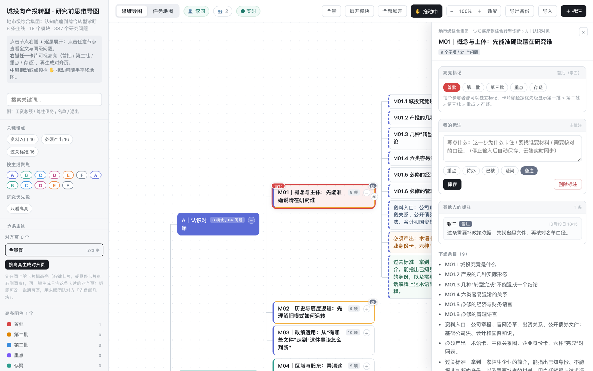

# 城投向产投转型：研究前思维导图（多人协作版）

把「城投 → 产投」转型的研究框架做成一张可交互的思维导图单页应用，并支持**多人实时标注、按人区分高亮、云端保存**。

- **在线访问（GitHub Pages）**：<https://hhw1998-ai.github.io/chengtou-mindmap/>
- 扣子生产站点（原始部署，不含多人标注）：<https://hv892cc3j7.coze.site/>
- **数据规模**：1 个根节点 + 6 条主线 + 16 个模块 + 387 个研究问题，共 523 个节点，最深 4 层
- **形态**：原生静态单页（无构建、无前端依赖，页面自包含）+ Supabase 云端存储



## 功能

### 阅读与导航
- **逐层展开/折叠**：点击节点右侧 `+` 逐层展开，点击节点查看全文与同级问题
- **搜索**：按关键词检索（如「工资总额 / 隐性债务 / 名单 / 退出」）
- **缩放 / 拖动 / 适配**：自由缩放、拖动点景、一键适配全图
- **任务地图**：16 个模块按主线归位，标注每个模块的资料入口 / 必须产出 / 过关标准

### 多人协作（本次新增）
- **首次进入填昵称**：昵称全局唯一；填完后自动记住，下次打开无需再填
- **只读浏览**：不填昵称也可以「先看看」，但标注按钮不可用
- **标注云端保存**：停笔自动保存到 Supabase，换设备 / 清缓存不会丢
- **实时同步**：任何人新增、修改、删除标注/高亮/对齐页，其他人的页面会实时更新（WebSocket 订阅）
- **按人区分**：标注列表和抽屉里显示作者昵称与时间；「其他人的标注」独立展示
- **高亮多作者**：每个参与者都可以对同一张卡片独立标高亮（首批/第二批/第三批/重点/存疑），卡片颜色按优先级、标记上显示标记人和人数
- **对齐页**：记录创建者，只有创建者能改名/删除，其他人只读
- **只看我的**：侧栏可筛选出自己名下的标注
- **权限隔离**：服务端 RLS 强制「只能增删改自己名下的记录」，别人改不了你的
- **写作状态**：顶栏显示当前用户、在线人数、同步状态（实时 / 连接中 / 离线）
- **旧数据迁移**：首次登录时若检测到本机旧标注，会提示一键上传并归属到你名下
- **导出/导入**：导出带作者信息的完整备份；导入时归属到当前用户

## 技术架构

```
浏览器（GitHub Pages 静态托管）
 ├─ index.html            原有单页应用（渲染 / 交互 / 本地缓存）
 ├─ js/cloud-sync.js      多人同步层（身份、云端读写、实时订阅、UI 增量）
 ├─ js/mm-config.js       Supabase 项目配置（URL + anon key，公开信息）
 └─ vendor/supabase.js    supabase-js v2 SDK（自托管，避免 CDN 不稳）

Supabase（免费版）
 ├─ Auth        匿名登录（免注册），uid 即用户 ID
 ├─ Postgres    mm_members / mm_annotations / mm_highlights / mm_pages
 ├─ RLS         所有人可读；只能增删改自己名下的记录
 └─ Realtime    postgres_changes 实时推送 + presence 在线人数
```

- 页面仍是纯静态，可直接托管在 GitHub Pages；Supabase 提供数据库、权限与实时能力。
- `anon key` 会出现在前端代码里，这是 Supabase 的设计（公开 key + RLS 才是安全边界）；**切勿**把 `service_role` key 放进前端。

## 目录结构

```
.
├── index.html              # 主页面：HTML + 内联 CSS/JS/SVG
├── js/
│   ├── cloud-sync.js       # 多人标注同步层（身份/读写/实时/迁移/UI 覆盖）
│   └── mm-config.js        # Supabase 项目 URL + anon key
├── vendor/
│   └── supabase.js         # supabase-js v2 UMD 包（自托管）
├── styles/
│   ├── main.css            # 模板遗留样式（未引用）
│   └── sync.css            # 多人协作新增样式
├── supabase/
│   └── schema.sql          # 建表 / 索引 / 触发器 / RLS / Realtime 配置
├── scripts/serve.ps1       # Windows 下的静态服务启动脚本
├── .coze                   # 扣子运行配置（python3 -m http.server）
├── AGENTS.md               # 项目约定
├── PROVENANCE.md           # 源码来源与校验记录
└── docs/screenshot.png     # 界面截图
```

## 本地运行

```bash
python3 -m http.server 8000
# 打开 http://localhost:8000
```

- 需要联网才能读写云端标注；断网时页面仍可浏览本机缓存。
- 第一次打开会弹「怎么称呼你？」，填昵称后即可标注；不填可点「先看看（只读）」。

## 数据与权限设计

| 表 | 用途 | 关键规则 |
|---|---|---|
| `mm_members` | 用户（uid = 匿名登录 ID，昵称唯一） | 只能写自己 |
| `mm_annotations` | 节点标注（每人每节点一条，后写覆盖） | 读所有人，写自己 |
| `mm_highlights` | 节点高亮（`mark` 0-4 对应五类） | 读所有人，写自己 |
| `mm_pages` | 按高亮类别生成的对齐页 | 读所有人，创建者才能改/删 |

建表与权限脚本见 [supabase/schema.sql](supabase/schema.sql)，可重复执行（幂等）。

## 更换 / 重建后端（部署到自己的 Supabase）

1. 用 GitHub 登录 <https://supabase.com>，新建项目（免费版即可）。
2. 在 SQL Editor 执行 `supabase/schema.sql`。
3. Authentication → Sign In / Providers → 打开 **Anonymous sign-ins**；建议把 `Rate limit for anonymous users` 调高（本项目设为 600/小时）。
4. Project Settings → API 复制 `Project URL` 和 `anon public key`，填入 `js/mm-config.js`。
5. 推送到 GitHub，Pages 自动更新。

## 已知限制

- **页面是公开链接**：拿到网址的人都能浏览并（填昵称后）参与标注；如需要限制，可后续加访问口令。
- **昵称全局唯一**，清除浏览器数据后会变成新身份，原来的昵称会被占用（可联系管理员在 Supabase 里清理旧用户）。
- 昵称修改后，其他人需要刷新页面才能看到新昵称（成员表未做实时订阅）。
- 高亮同一张卡片时若多人标了不同类别，卡片颜色按「首批 > 第二批 > 第三批 > 重点 > 存疑」取优先级展示，标记人与人数可在抽屉和悬停提示里看到。
- 本应用面向桌面端使用；手机可以打开和浏览，但操作体验以桌面为主。

## 源码来源

本仓库源码从扣子编程项目（ID `7696808110719172646`）获取，获取方式、SHA-256 校验及与线上版本的差异说明见 [PROVENANCE.md](PROVENANCE.md)。
